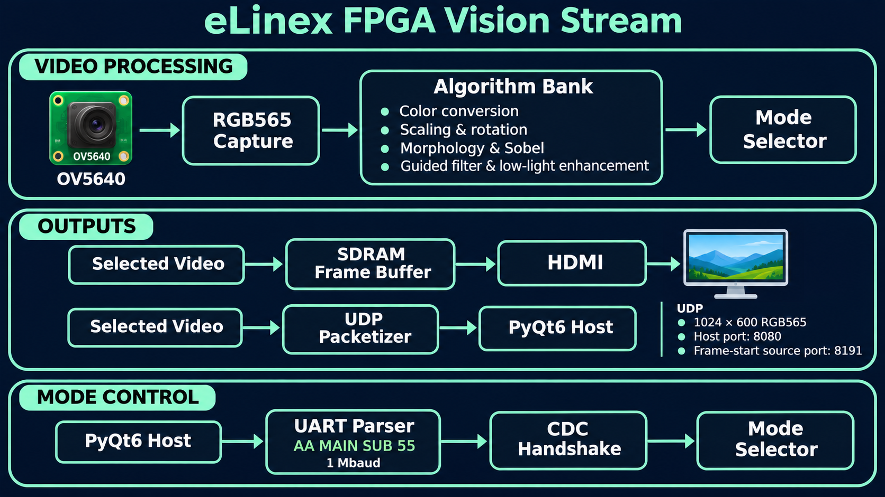

# eLinex Vision Stream

[中文](#中文) · [English](#english)



## 中文

2026 年全国大学生集成电路创新创业大赛国奖项目。系统从 OV5640 接收 RGB565 像素流，在 eLinex FPGA 上执行可切换的图像处理，并通过 HDMI 和 UDP 提供显示。PyQt6 上位机负责算法选择、预览、截图和录像。

### 图像处理与传输

1. **采集和处理**。OV5640 输出 RGB565，FPGA 按所选模式处理像素流。基础工程包含 YCbCr / HSV 转换、缩放、旋转、灰度形态学和 Sobel。增强工程加入引导滤波、磨皮和暗光增强。
2. **显示与图传**。选中的视频流可经 SDRAM 帧缓存送往 HDMI，也可经 UDP 打包器发往上位机。上位机监听 UDP 8080，按 1024 × 600 大端 RGB565 组帧，以源端口 8191 识别帧首。接收线程组帧，后台线程转换像素格式，界面绘制最新图像。
3. **模式切换**。上位机以 1 Mbaud 发送四字节 `AA MAIN SUB 55`。FPGA 解析命令，经跨时钟域握手传递控制字，在帧同步边界切换算法。上位机清空旧帧，等待下一帧首重新同步。

### 工程入口

| 入口 | 用途 |
| --- | --- |
| [基础工程](fpga/base/ov5640.qpf) | 颜色空间、几何变换、滤波和 Sobel |
| [增强工程](fpga/enhancement/ov5640.qpf) | 引导滤波、磨皮和暗光增强 |
| [PyQt6 上位机](host/main.py) | 串口控制、UDP 组帧、预览和录像 |
| [算法索引](docs/ALGORITHM_INDEX.md) | 从界面选项和模式码定位 RTL 与 IP |
| [系统架构](docs/ARCHITECTURE.md) · [上位机说明](docs/HOST_SOFTWARE.md) | 时钟域、图传协议与线程模型 |

### 构建与运行

在 eLinex/eHiWay 中打开对应 QPF，目标器件为 EP1S80F1508C6。在工程根目录启动 Windows 上位机。

```powershell
python -m venv .venv
.\.venv\Scripts\python.exe -m pip install -r requirements.txt
.\.venv\Scripts\python.exe host/main.py
```

连接摄像头、HDMI、串口及局域网链路后，先用原图模式核对 HDMI 和 UDP 预览，再选一种滤波模式检查帧切换。上位机选择的项目分区要与烧录工程一致。基础版的主模式 10 对应 Sobel，增强版的主模式 10 对应引导滤波或磨皮。UDP 组帧依赖帧首标记，协议没有分片序号或重传。 [第三方说明](THIRD_PARTY_NOTICES.md)

## English

This national-prize entry from the 2026 China collegiate IC innovation competition processes OV5640 RGB565 video on an eLinex FPGA. It outputs video over HDMI and UDP and uses a PyQt6 desktop app for mode selection, preview, snapshots, and recording.

### Video and control paths

1. **Capture and processing.** The FPGA routes the camera stream through the selected algorithm. The base design covers color conversion, scaling, rotation, morphology, and Sobel. The enhancement design adds guided filtering, skin smoothing, and low-light enhancement.
2. **HDMI and UDP.** The selected stream can go through SDRAM buffering to HDMI or directly to the UDP packetizer. The host listens on UDP port 8080 and assembles 1024 × 600 big-endian RGB565 frames. Source port 8191 marks the start of a frame. A background worker decodes the pixels and the UI displays the latest frame.
3. **Mode control.** The host sends `AA MAIN SUB 55` over UART at 1 Mbaud. The FPGA transfers the decoded command across clock domains and applies it at a frame boundary. The host discards stale data and resynchronizes on the next frame marker.

### Build and run

Open the [base QPF](fpga/base/ov5640.qpf) or [enhancement QPF](fpga/enhancement/ov5640.qpf) in eLinex/eHiWay for EP1S80F1508C6. Start the [host application](host/main.py) with the PowerShell commands under [构建与运行](#构建与运行). Connect the camera, display, serial port, and local network. Check both video outputs in passthrough mode, then switch to a filter and check that the preview resynchronizes.

Match the host's project selection to the programmed design. Main mode 10 selects Sobel in the base build and guided filtering or skin smoothing in the enhancement build. UDP frame assembly uses a frame-start marker, with no per-fragment sequence numbers or retransmission. [Architecture and protocol](docs/ARCHITECTURE.md) · [Algorithm and RTL index](docs/ALGORITHM_INDEX.md) · [Host internals](docs/HOST_SOFTWARE.md) · [Third-party notices](THIRD_PARTY_NOTICES.md)
