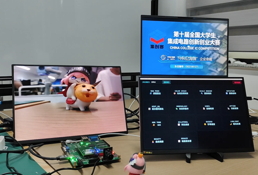
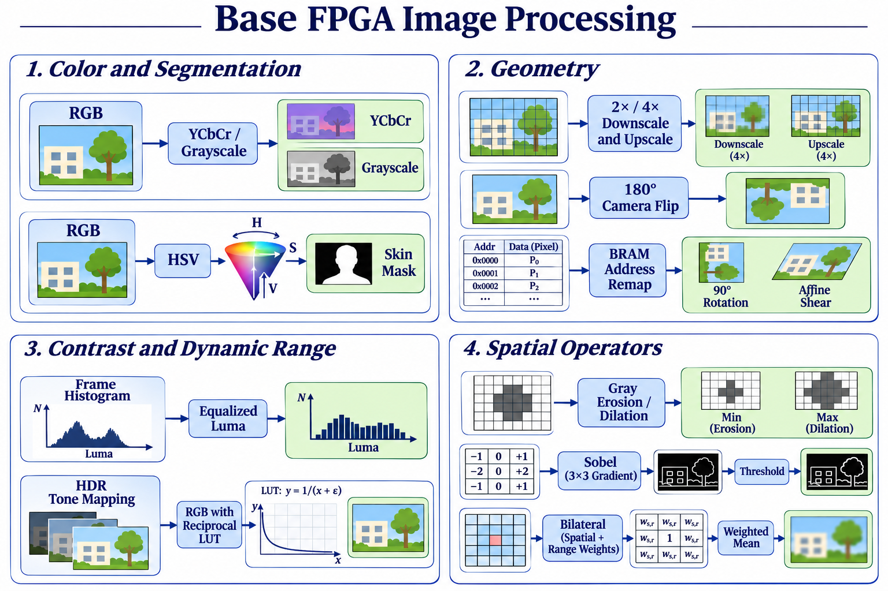
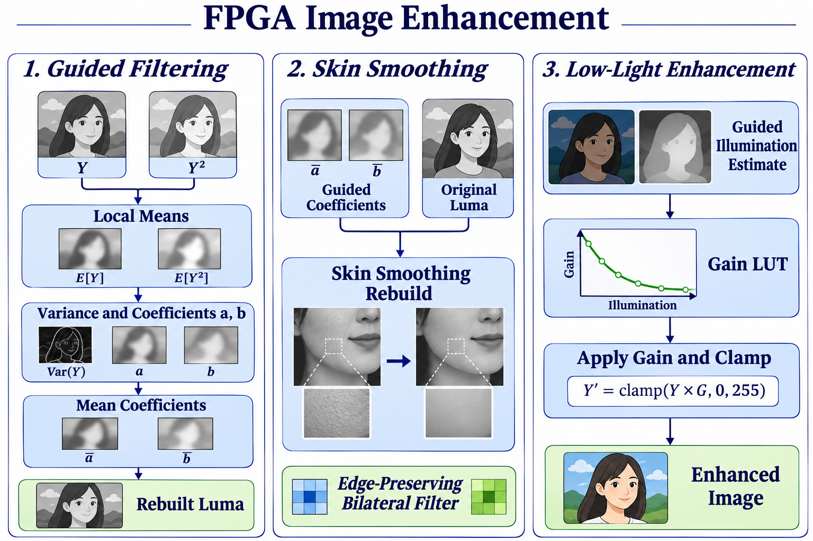
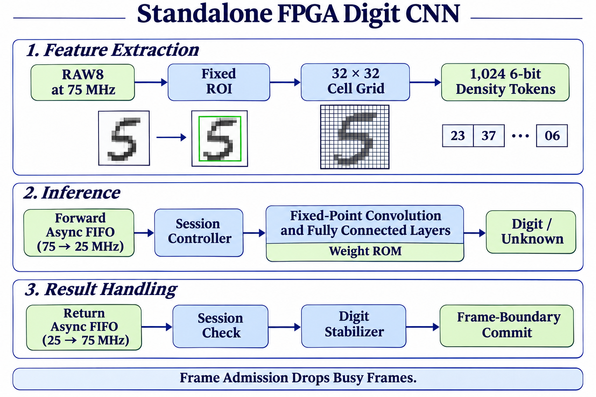

# eLinex Vision Stream

[中文](#中文) · [English](#english)

<p align="center">
  
  <br>
  <em>中科亿海微赛道现场实拍 · Competition demo</em>
</p>

## 中文

2026 年全国大学生集成电路创新创业大赛中科亿海微赛道全国三等奖项目。系统从 OV5640 接收 RGB565 像素流，在 eLinex FPGA 上执行可切换的图像处理，并通过 HDMI 和 UDP 提供显示。PyQt6 上位机负责算法选择、预览、截图和录像。

### 图像处理与传输

1. **采集和处理**。OV5640 输出 RGB565，FPGA 按所选模式处理像素流。基础工程包含 YCbCr / HSV 转换、缩放、旋转、灰度形态学和 Sobel。增强工程加入引导滤波、磨皮和暗光增强。
2. **显示与图传**。SDRAM 缓存摄像头输入，显示时钟域读取像素并执行算法。处理结果送 HDMI，基础版另将处理结果送入 UDP 打包器。上位机监听 UDP 8080，按 1024 × 600 小端 RGB565 组帧，以源端口 8191 识别帧首。接收线程组帧，后台线程转换像素格式，界面绘制最新图像。
3. **模式切换**。上位机以 1 Mbaud 发送四字节 `AA MAIN SUB 55`。FPGA 解析命令，经跨时钟域握手传递控制字，在帧同步边界切换算法。上位机清空旧帧，等待下一帧首重新同步。

### 算法与硬件实现

图中的示例画面、曲线和公式用于解释算法原理。



| 基础版算法 | 硬件实现 |
| --- | --- |
| YCbCr / 灰度、HSV / 肤色分割 | 定点颜色变换。Y 供灰度算子使用，H/S 阈值生成肤色掩码 |
| 2× / 4× 缩放 | 缩小由坐标抽样和有效窗口控制，放大使用行缓存和 3×3 均值平滑 |
| 180° / 90° 旋转、仿射错切 | 180° 使用 OV5640 翻转寄存器。90° 和错切由 FPGA 通过 BRAM 地址重映射实现 |
| 直方图均衡、HDR 色调映射 | 按帧统计灰度并映射亮度。HDR 使用定点倒数查表压缩动态范围 |
| 灰度腐蚀与膨胀、Sobel、双边滤波 | 分别使用邻域最小/最大值、3×3 梯度阈值和空间/像素差联合加权 |



增强版先对 Y 和 Y² 求局部均值，由方差求引导系数 a、b，再对系数求局部均值并重建亮度。磨皮分支结合引导系数、原始亮度和双边平滑。暗光分支使用引导滤波估计照度，通过增益查表提升暗部并限制输出范围。

### 独立数字识别 CNN



固定 ROI 被分为 32 × 32 个单元，生成 1,024 个 6 位暗像素密度特征。75 MHz 前端经异步 FIFO 将特征送至 25 MHz 定点卷积和全连接分类器，结果返回前端进行会话校验和稳定化，再在帧边界提交。分类器忙时按整帧丢弃。仓库包含独立 RTL、仿真脚本和 163 个 RAW8 样本。板级集成需要统一工程提供视频顶层和约束。[CNN 源码与验证说明](fpga/cnn_standalone/)

### 工程入口

| 入口 | 用途 |
| --- | --- |
| [基础工程](fpga/base/ov5640.qpf) | 颜色空间、几何变换、滤波和 Sobel |
| [增强工程](fpga/enhancement/ov5640.qpf) | 引导滤波、磨皮和暗光增强 |
| [PyQt6 上位机](host/main.py) | 串口控制、UDP 组帧、预览和录像 |
| [算法索引](docs/ALGORITHM_INDEX.md) | 从界面选项和模式码定位 RTL 与 IP |
| [系统架构](docs/ARCHITECTURE.md) · [上位机说明](docs/HOST_SOFTWARE.md) | 时钟域、图传协议与线程模型 |

### 构建与运行

在 eLinex/eHiWay 中打开对应 QPF，目标器件为 EP1S80F1508C6。在工程根目录启动 Windows 上位机。

```powershell
python -m venv .venv
.\.venv\Scripts\python.exe -m pip install -r requirements.txt
.\.venv\Scripts\python.exe host/main.py
```

连接摄像头、HDMI、串口及局域网链路后，先用原图模式核对 HDMI 和 UDP 预览，再选一种滤波模式检查帧切换。上位机选择的项目分区要与烧录工程一致。基础版的主模式 10 对应 Sobel，增强版的主模式 10 对应引导滤波或磨皮。UDP 组帧依赖帧首标记，协议没有分片序号或重传。 [第三方说明](THIRD_PARTY_NOTICES.md)

## English

This project won a national third prize in the 中科亿海微 (eLinex) track of the 2026 China collegiate IC innovation competition. It processes OV5640 RGB565 video on an eLinex FPGA. It outputs video over HDMI and UDP and uses a PyQt6 desktop app for mode selection, preview, snapshots, and recording.

### Video and control paths

1. **Capture and processing.** The FPGA routes the camera stream through the selected algorithm. The base design covers color conversion, scaling, rotation, morphology, and Sobel. The enhancement design adds guided filtering, skin smoothing, and low-light enhancement.
2. **HDMI and UDP.** SDRAM buffers camera input before display-domain processing. The processed stream feeds HDMI and, in the base build, the UDP packetizer. The host listens on UDP port 8080 and assembles 1024 × 600 little-endian RGB565 frames. Source port 8191 marks the start of a frame. A background worker decodes the pixels and the UI displays the latest frame.
3. **Mode control.** The host sends `AA MAIN SUB 55` over UART at 1 Mbaud. The FPGA transfers the decoded command across clock domains and applies it at a frame boundary. The host discards stale data and resynchronizes on the next frame marker.

### Algorithm coverage

Illustrative images, curves, and equations explain the algorithm concepts.

The [base diagram](docs/base-algorithms.png) groups the selectable modes by hardware structure. Fixed-point YCbCr and HSV conversion support grayscale and skin segmentation. Scaling uses coordinate sampling, line buffering, and 3×3 smoothing. The OV5640 handles 180° rotation, while FPGA BRAM address remapping handles 90° rotation and affine shear. Frame histogram equalization and LUT-based HDR tone mapping handle contrast. Neighborhood min/max, thresholded Sobel gradients, and spatial/range-weighted averaging implement erosion/dilation, edge detection, and bilateral filtering.

The [enhancement diagram](docs/enhancement-algorithms.png) follows local means of Y and Y² through guided coefficient estimation and luma reconstruction. Skin smoothing combines guided coefficients and bilateral filtering. Low-light enhancement estimates illumination, then applies a LUT-based gain and clamps the output.

### Standalone digit CNN

The [CNN pipeline](docs/cnn-pipeline.png) extracts 1,024 six-bit density tokens from a 32 × 32 grid over a fixed RAW8 ROI. A 75 MHz frontend sends tokens over an asynchronous FIFO to a 25 MHz fixed-point convolution and fully connected classifier. A return FIFO carries results for session checks and stabilization before frame-boundary commit. The extraction includes RTL, simulation scripts, and 163 RAW8 samples. Board integration requires the original video top and constraints. [CNN package](fpga/cnn_standalone/)

### Build and run

Open the [base QPF](fpga/base/ov5640.qpf) or [enhancement QPF](fpga/enhancement/ov5640.qpf) in eLinex/eHiWay for EP1S80F1508C6. Start the [host application](host/main.py) with the PowerShell commands under [构建与运行](#构建与运行). Connect the camera, display, serial port, and local network. Check both video outputs in passthrough mode, then switch to a filter and check that the preview resynchronizes.

Match the host's project selection to the programmed design. Main mode 10 selects Sobel in the base build and guided filtering or skin smoothing in the enhancement build. UDP frame assembly uses a frame-start marker, with no per-fragment sequence numbers or retransmission. [Architecture and protocol](docs/ARCHITECTURE.md) · [Algorithm and RTL index](docs/ALGORITHM_INDEX.md) · [Host internals](docs/HOST_SOFTWARE.md) · [Third-party notices](THIRD_PARTY_NOTICES.md)
